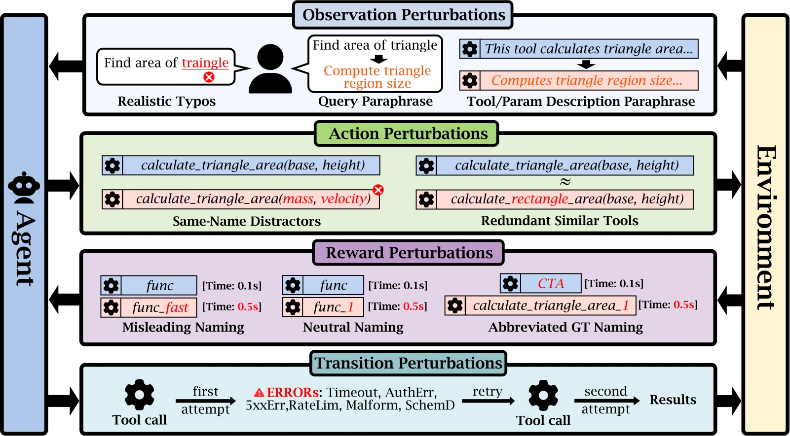
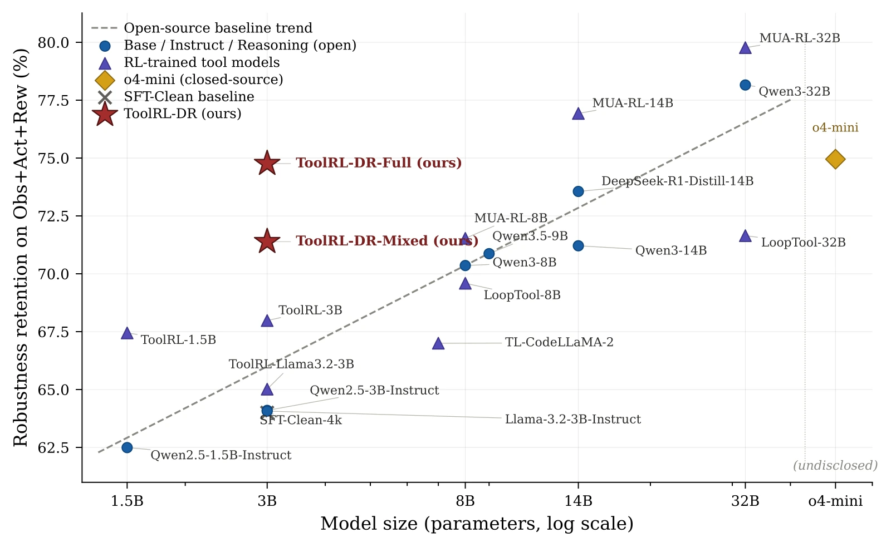

<div align="center">

# AgentRobustBench

**English** | [简体中文](README_zh-CN.md)

**A Sim-to-Real Benchmark and Domain-Randomized RL Recipe for Tool-Use Agents**

NeurIPS 2026 · Evaluations & Datasets Track

[](https://arxiv.org/abs/2605.11928)
[](https://huggingface.co/datasets/AgentRobustBench/AgentRobustBench)
[](https://huggingface.co/spaces/willchow66/AgentRobustBench)

**199 seed tasks · 22 perturbation types · 3,721 evaluation cases · 21 models evaluated**

[Evaluate the benchmark](#evaluate-the-full-benchmark) · [Benchmark](#benchmark) · [Results](#results) · [Checkpoints](#model-checkpoints) · [Training](#reproducing-toolrl-dr-optional) · [Citation](#citation)

</div>

AgentRobustBench measures how tool-use language agents handle failures that arise in deployment, from typos and ambiguous tool names to API timeouts. It pairs a robustness benchmark with **ToolRL-DR**, a reinforcement learning recipe that trains agents on varied tool-use trajectories.

## Evaluate the full benchmark

Run **ToolRL-DR-Full** or **ToolRL-DR-Mixed** on the complete AgentRobustBench: **3,721 evaluation cases**, covering the clean baseline and all 22 perturbation types. Choose where the model will run:

| Your computer | How to run |
| --- | --- |
| CPU only, including an Intel Mac | Direct inference with `--device cpu`; no GPU or model server needed. |
| Apple Silicon Mac | Use its built-in GPU through **MPS** with `--device auto`, when macOS and the installed PyTorch support it. No NVIDIA GPU or CUDA is needed. |
| Windows/Linux with an NVIDIA GPU | Use **CUDA** with `--device auto`. Install a compatible NVIDIA driver and CUDA-enabled PyTorch using the [official installation selector](https://pytorch.org/get-started/locally/). The [vLLM guide](scripts/README.md) is another option on supported Linux machines. |
| Windows with an Intel or AMD GPU | The current runner has no dedicated adapter for these GPU backends. Use `--device cpu` for this workflow. |
| Laptop connected to an existing model server | Install only the [evaluation client](scripts/README.md#if-you-already-have-a-model-server). The server does the model inference. |

A supported GPU can make **model generation faster than CPU inference**. The speedup depends on the GPU, available memory, and input/output lengths; it has not been measured for these checkpoints yet. Rule-based scoring runs on CPU, and choosing a GPU does not speed up the initial download.

The HF weights are about **13.6 GB per checkpoint**. CPU inference uses float32 and needs additional RAM beyond the weights; **32 GB RAM is a practical starting recommendation, not a measured minimum**. Accelerator inference uses half precision. Download speed and inference time depend on your computer. See [validation status](docs/REPRODUCIBILITY.md) for what has been tested.

### 1. Install Python and the project dependencies

For a new setup, use **Conda** to install Python and create an isolated environment.

**Install Conda if needed.** Run `conda --version`. If the command is not found, install [Miniforge using its official instructions](https://github.com/conda-forge/miniforge#install). Choose the installer for your operating system and processor. On macOS/Linux, reopen Terminal after installation; on Windows, open **Miniforge Prompt** from the Start menu. An existing Anaconda, Miniconda, or Miniforge installation also works.

**Use one Conda environment for this workflow.** Activate it with `conda activate`; the commands below do not create an additional `.venv`. On Windows, use Miniforge Prompt or a PowerShell session where Conda already works.

**Install Python 3.12, pip, and Git in a new environment:**

```bash
conda create -n agentrobustbench -c conda-forge --override-channels python=3.12 pip git -y
conda activate agentrobustbench
python --version
git --version
```

The create command installs Python itself; a separate system Python installation is not required. Keep this environment active for all following commands. If you already have a working Python 3.11/3.12 `.venv` from the earlier instructions, keep using it and continue below.

**Download the project:**

```bash
git clone --depth 1 https://github.com/WillChow66/AgentRobustBench.git
cd AgentRobustBench
```

If you already have the project, open its directory and run `git pull` instead of cloning again.

**Install the dependencies.** On macOS, proceed directly to the requirements command below. On CPU-only Linux/Windows, first install CPU PyTorch:

```bash
python -m pip install torch --index-url https://download.pytorch.org/whl/cpu
```

On Linux/Windows with an NVIDIA GPU, first install CUDA-enabled PyTorch using the [official installation selector](https://pytorch.org/get-started/locally/). Then, on every platform, install the project dependencies:

```bash
python -m pip install -r scripts/requirements-local.txt
```

This also installs the Hugging Face `hf` command used for checkpoint downloads below.

### 2. Check your environment

```bash
python scripts/evaluate_checkpoint.py --device auto --check
```

This prints your platform, selected device, available system RAM, and package versions **without downloading weights**. Read the `Device:` line:

| Output | Device used for model generation |
| --- | --- |
| `Device: mps` | The Mac GPU through Apple MPS. |
| `Device: cuda` | The NVIDIA GPU through CUDA. |
| `Device: cpu` | The CPU; no supported accelerator was detected. |

`auto` tries CUDA first, then MPS, then CPU. If you expected CUDA but see `cpu`, check that your NVIDIA driver and CUDA-enabled PyTorch are installed. On Mac, check MPS availability with your macOS/PyTorch versions. To explicitly select a device, replace `auto` with `cpu`, `mps`, or `cuda`; an unavailable explicit device produces an error.

### 3. Download Full or Mixed

Download the checkpoint you want to evaluate. To evaluate both models, run both download commands.

**Full:**

```bash
hf download willchow66/ToolRL-DR-Full-Qwen2.5-3B --revision caf3c8dfd3f9914d056892c3ab740d35ee9a0eab
```

**Mixed:**

```bash
hf download willchow66/ToolRL-DR-Mixed-Qwen2.5-3B --revision c93ea7730b10cb0c16025705f2753859ec639a5e
```

The revisions match [the evaluator's checkpoint configuration](configs/checkpoints.json). Each command prints the local cache path when finished. **If the same files and revision are already cached, they are reused; missing files are downloaded.** You do not need to copy the weights into the project folder or pass their cache path to the evaluator. The repositories are public and do not require login for downloads.

### 4. Choose what to evaluate

**Complete benchmark (3,721 cases per model)**

Run Full:

```bash
python scripts/evaluate_checkpoint.py --checkpoint full --suite full --device auto
```

For Mixed, run:

```bash
python scripts/evaluate_checkpoint.py --checkpoint mixed --suite full --device auto
```

Use `--checkpoint full` or `--checkpoint mixed` to choose the model. `--suite full` runs the complete benchmark and is the default scope. The examples below work with either checkpoint. The evaluator reuses the Hugging Face cache or downloads missing files. Benchmark data comes with the repository. To force CPU inference, use `--device cpu`.

**Available categories and subtypes**

- `clean`: unperturbed baseline (199 cases).
- `observation` (4 subtypes, 796 cases):
  - `realistic_typos` (typos), `query_paraphrase` (user query paraphrase).
  - `paraphrase_tool_description` (tool description rewrite), `paraphrase_parameter_description` (parameter description rewrite).
- `action` (6 subtypes, 836 cases):
  - `same_name_A`, `same_name_B`, `same_name_C`, `same_name_D`, `same_name_E` (five same-name distractor variants).
  - `redundant` (functionally similar distractor).
- `reward` (6 subtypes affecting tool choice, 696 cases):
  - `CD`, `CD_NT`, `CD_AB` (misleading descriptions with three naming variants).
  - `TD`, `TD_NT`, `TD_AB` (response-time descriptions with three naming variants).
- `transition` (6 runtime error subtypes, 1,194 cases):
  - `timeout`, `rate_limit` (429), `auth_error` (401).
  - `server_error` (500), `malformed_response` (invalid JSON), `schema_drift` (changed response structure).

**Select categories or sample cases**

```bash
# All cases in one category
python scripts/evaluate_checkpoint.py --checkpoint full --device auto --select observation

# All cases in one subtype
python scripts/evaluate_checkpoint.py --checkpoint full --device auto --select timeout

# Combine a category, a subtype, and the clean baseline
python scripts/evaluate_checkpoint.py --checkpoint full --device auto --select observation timeout clean

# Five cases from each of the four observation subtypes, 20 total
python scripts/evaluate_checkpoint.py --checkpoint full --device auto --select observation --samples-per-type 5

# Three cases from the timeout subtype
python scripts/evaluate_checkpoint.py --checkpoint full --device auto --select timeout --samples-per-type 3

# Quick check: three cases each from the clean baseline and the typo subtype
python scripts/evaluate_checkpoint.py --checkpoint full --device auto --select clean realistic_typos --samples-per-type 3 --seed 42
```

Separate names after `--select` with spaces and match their capitalization. A category expands to all of its subtypes, and overlapping selections run once. Include `clean` to evaluate the unperturbed baseline alongside a selection.

`--samples-per-type N` randomly draws up to N eligible single-turn cases per selected subtype and per selected clean baseline, without replacement. The same dataset and `--seed` (default 42) reproduce the selection. Without `--select`, sampling applies to all 22 subtypes and the clean baseline. Sampling reduces the number of cases to evaluate and still loads the full model.

### 5. Read the results

A completed run prints the number of scored cases, `n`, and a new output directory under `results/`. A full run reports **`n=3721`**. A subset run reports the count for the chosen groups and sample size.

| File | Contents |
| --- | --- |
| `comparison.csv` (complete runs) | Your measured `Clean`, `Pert. Acc.`, and four category accuracies, alongside released reference scores and differences in percentage points. |
| `scores.json` | All aggregate scores, including results by source benchmark and perturbation type. |
| `*.predictions.jsonl`, `transition_*/*.predictions.jsonl` | Generated text and parsed tool calls for the static and runtime cases. |
| `per_sample_scores.jsonl` | A score for every evaluation case. |
| `_run_summary.json` | Processed counts and errors. |
| `run_metadata.json` | Checkpoint revision, data hashes, selected subtypes, sampling settings, device, precision, package versions, seed, and timings. |

To compare with the paper, use the matching columns in **`comparison.csv`**. `Clean` measures the 199 clean cases; `Pert. Acc.` measures the 3,522 perturbed cases. The console's top-level `accuracy` combines both groups.

Use `scores.json` and `per_sample_scores.jsonl` to inspect subset results. See [metric definitions](docs/REPRODUCIBILITY.md) or the [optional vLLM server guide](scripts/README.md) for more detail.

## Benchmark



| Category | What changes | Example |
| --- | --- | --- |
| Observation | The input the agent sees | A typo in the user query |
| Action | The tools available to the agent | A distractor tool with the same name |
| Reward-relevant metadata | Information that steers tool choice | A misleading tool name or response-time annotation |
| Transition | The response to a tool call | A transient timeout on the first attempt |

The [Hugging Face dataset](https://huggingface.co/datasets/AgentRobustBench/AgentRobustBench) contains **2,718 static records**. The default single-turn runner evaluates **2,527** of them, skipping **191 multi-turn records**, and adds **1,194 runtime cases** (199 clean tasks × 6 error types), for **3,721 evaluated cases** in total. Submit predictions or browse per-category scores on the [live leaderboard](https://huggingface.co/spaces/willchow66/AgentRobustBench).

## Results



The plot shows how much clean accuracy models retain across Observation, Action, and Reward perturbations. At 3B parameters, ToolRL-DR-Full improves retention over the size-matched ToolRL baseline. In a separate runtime evaluation, it closes about 27% of the Transition gap without training on Transition errors. See the [paper](https://arxiv.org/abs/2605.11928) for the metric and experimental settings.

## Layout

| Directory | Contents |
|-----------|----------|
| `hf_data/datasets/api_eval/` | 17 JSONL files: 16 static perturbation cells + the clean baseline (3,721 predictions per model in total). The 6 Transition variants are produced at runtime by `scripts/run_eval.py`, not stored as separate files. |
| `scripts/` | Direct checkpoint runner (`evaluate_checkpoint.py`), endpoint runner (`run_eval.py`), reparser (`reparse_predictions.py`), model manifest, and SLURM templates. See `scripts/README.md`. |
| `leaderboard/` | HuggingFace Space implementation: Gradio app, deterministic scorer, leaderboard CSV. See `leaderboard/README.md`. |
| `training/` | Reproduction recipe for ToolRL-DR-Full and ToolRL-DR-Mixed: the parquets actually fed to the GRPO trainer (`train.parquet`, `mixed_train.parquet`, `test.parquet`), the reference jsonl→parquet converter, our drop-in reward-score patch (`rlla_perturbed.py`), the GRPO launcher, and a hyperparameter manifest. See `training/README.md`. |

## Model checkpoints

| Checkpoint | Training data | Model card |
| --- | --- | --- |
| ToolRL-DR-Full | Perturbed trajectories | [Hugging Face](https://huggingface.co/willchow66/ToolRL-DR-Full-Qwen2.5-3B) |
| ToolRL-DR-Mixed | Clean and perturbed trajectories | [Hugging Face](https://huggingface.co/willchow66/ToolRL-DR-Mixed-Qwen2.5-3B) |

The checkpoints are based on Qwen2.5-3B-Instruct and use the [Qwen Research License](https://huggingface.co/Qwen/Qwen2.5-3B-Instruct/blob/main/LICENSE). See [training/](training/) for the training data and reproduction instructions.

## Reproducing ToolRL-DR (optional)

The parquets fed to the GRPO trainer are already in `training/data/`,
so you can train without running the data converter. After the one-time setup
described in `training/README.md` (clone public ToolRL, drop in the
`rlla_perturbed.py` reward patch, set `PYTHONPATH`):

```bash
# DR-Full
TRAIN_FILE=training/data/train.parquet \
VAL_FILE=training/data/test.parquet \
BASE_MODEL=Qwen/Qwen2.5-3B-Instruct \
EXPERIMENT_NAME=toolrl-dr-full \
N_GPUS=2 ROLLOUT_TP_SIZE=1 \
bash training/grpo_launch.sh

# DR-Mixed: change TRAIN_FILE to training/data/mixed_train.parquet
```

## Citation

The current arXiv record lists the paper under its original title.

```bibtex
@misc{zhou2026whensimulationlies,
  title         = {When Simulation Lies: A Sim-to-Real Benchmark and Domain-Randomized RL Recipe for Tool-Use Agents},
  author        = {Zhou, Xiaolin and Yuan, Aojie and Luo, Zheng and Ling, Zipeng and
                   Pan, Xixiao and Gao, Yicheng and Zhang, Haiyue and Li, Jiate and
                   Jiang, Shuli and Wang, Prince Zizhuang and Zhu, Zixuan and
                   Liu, Jinbo and Rossi, Ryan A. and Wei, Hua and Hu, Xiyang},
  year          = {2026},
  eprint        = {2605.11928},
  archivePrefix = {arXiv},
  primaryClass  = {cs.AI}
}
```

## License

Code: [Apache-2.0](LICENSE). Data: see per-source license documented in the paper.
