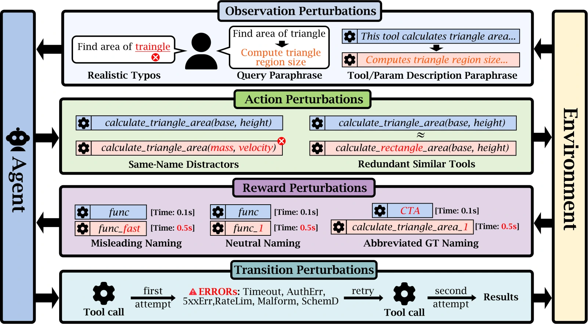
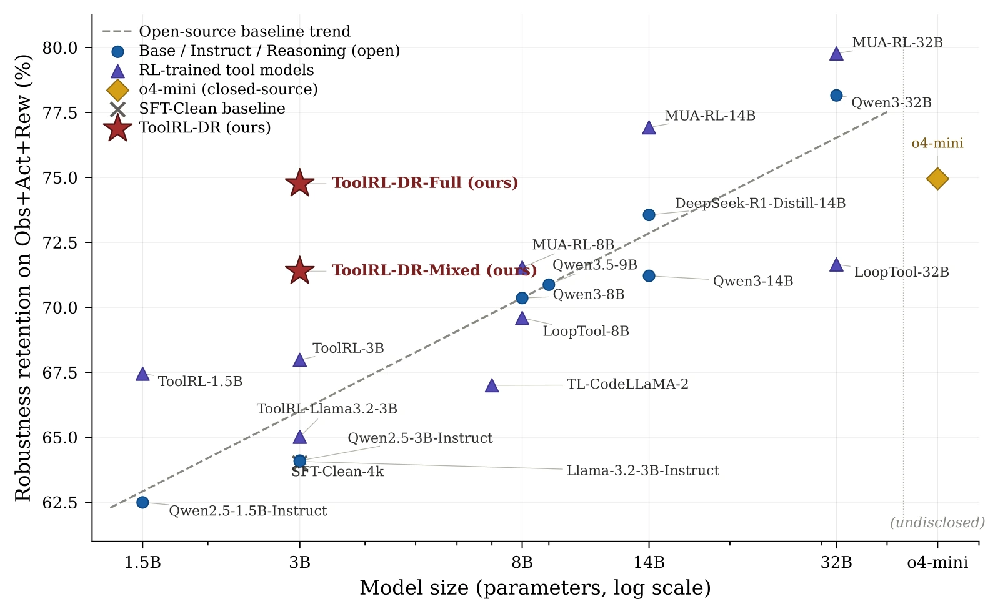

<div align="center">

# AgentRobustBench

**A Sim-to-Real Benchmark and Domain-Randomized RL Recipe for Tool-Use Agents**

NeurIPS 2026 · Evaluations & Datasets Track

[](https://arxiv.org/abs/2605.11928)
[](https://huggingface.co/datasets/robustbench-tc/RobustBench-TC)
[](https://huggingface.co/spaces/willchow66/AgentRobustBench)

**199 seed tasks · 22 perturbation types · 3,721 evaluation cases · 21 models evaluated**

[Benchmark](#benchmark) · [Results](#results) · [Quick start](#quick-start) · [Training](#reproducing-toolrl-dr-optional) · [Citation](#citation)

</div>

AgentRobustBench measures how tool-use language agents handle failures that arise in deployment, from typos and ambiguous tool names to API timeouts. It pairs a robustness benchmark with **ToolRL-DR**, a reinforcement learning recipe that trains agents on varied tool-use trajectories.

## Benchmark



| Category | What changes | Example |
| --- | --- | --- |
| Observation | The input the agent sees | A typo in the user query |
| Action | The tools available to the agent | A distractor tool with the same name |
| Reward-relevant metadata | Information that steers tool choice | A misleading tool name or response-time annotation |
| Transition | The response to a tool call | A transient timeout on the first attempt |

The [Hugging Face dataset](https://huggingface.co/datasets/robustbench-tc/RobustBench-TC) contains **2,718 static records**. The evaluation runner adds **1,003 runtime cases** for a total of **3,721**. Submit predictions or browse per-category scores on the [live leaderboard](https://huggingface.co/spaces/willchow66/AgentRobustBench).

## Results



The plot shows how much clean accuracy models retain across Observation, Action, and Reward perturbations. At 3B parameters, ToolRL-DR-Full improves retention over the size-matched ToolRL baseline. In a separate runtime evaluation, it closes about 27% of the Transition gap without training on Transition errors. See the [paper](https://arxiv.org/abs/2605.11928) for the metric and experimental settings.

## Layout

| Directory | Contents |
|-----------|----------|
| `hf_data/datasets/api_eval/` | 17 JSONL files: 16 static perturbation cells + the clean baseline (3{,}721 predictions per model in total). The 6 Transition variants are produced at runtime by `scripts/run_eval.py`, not stored as separate files. |
| `scripts/` | Inference runner (`run_eval.py`), reparser (`reparse_predictions.py`), model manifest, and SLURM templates. See `scripts/README.md`. |
| `leaderboard/` | HuggingFace Space implementation: Gradio app, deterministic scorer, leaderboard CSV. See `leaderboard/README.md`. |
| `training/` | Reproduction recipe for ToolRL-DR-Full and ToolRL-DR-Mixed: the parquets actually fed to the GRPO trainer (`train.parquet`, `mixed_train.parquet`, `test.parquet`), the reference jsonl→parquet converter, our drop-in reward-score patch (`rlla_perturbed.py`), the GRPO launcher, and a hyperparameter manifest. See `training/README.md`. |

## Training artifacts

The training data and instructions for reproducing ToolRL-DR-Full and ToolRL-DR-Mixed are in [training/](training/).

## Quick start

```bash
# 1. Run inference against any vLLM endpoint:
python scripts/run_eval.py \
    --model-name <model-id> \
    --endpoint <vllm-endpoint>/v1 \
    --data-dir hf_data/datasets/api_eval \
    --output-dir results/<safe-name> \
    --mode single \
    --skip-multi-turn

# 2. Score the predictions (deterministic; no API key required):
python leaderboard/scoring/eval_results.py \
    --predictions results/<safe-name> \
    --output      results/<safe-name>/scores.json

# 3. Or submit `results/<safe-name>/` to the public leaderboard Space
#    (the Space runs the same scorer server-side).
```

The full SLURM end-to-end pipeline (boot vLLM → 17 single-mode files →
6 Transition variants → score → teardown) is in `scripts/slurm/`.

## Reproducing ToolRL-DR (optional)

The parquets fed to the GRPO trainer are already in `training/data/`,
so you can train without running the data converter. After the one-time setup
described in `training/README.md` (clone public ToolRL, drop in the
`rlla_perturbed.py` reward patch, set `PYTHONPATH`):

```bash
# DR-Full
TRAIN_FILE=training/data/train.parquet \
VAL_FILE=training/data/test.parquet \
BASE_MODEL=Qwen/Qwen2.5-3B-Instruct \
EXPERIMENT_NAME=toolrl-dr-full \
N_GPUS=2 ROLLOUT_TP_SIZE=1 \
bash training/grpo_launch.sh

# DR-Mixed: change TRAIN_FILE to training/data/mixed_train.parquet
```

## Citation

The current arXiv record lists the paper under its original title.

```bibtex
@misc{zhou2026whensimulationlies,
  title         = {When Simulation Lies: A Sim-to-Real Benchmark and Domain-Randomized RL Recipe for Tool-Use Agents},
  author        = {Zhou, Xiaolin and Yuan, Aojie and Luo, Zheng and Ling, Zipeng and
                   Pan, Xixiao and Gao, Yicheng and Zhang, Haiyue and Li, Jiate and
                   Jiang, Shuli and Wang, Prince Zizhuang and Zhu, Zixuan and
                   Liu, Jinbo and Rossi, Ryan A. and Wei, Hua and Hu, Xiyang},
  year          = {2026},
  eprint        = {2605.11928},
  archivePrefix = {arXiv},
  primaryClass  = {cs.AI}
}
```

## License

Code: Apache-2.0. Data: see per-source license documented in the paper.
