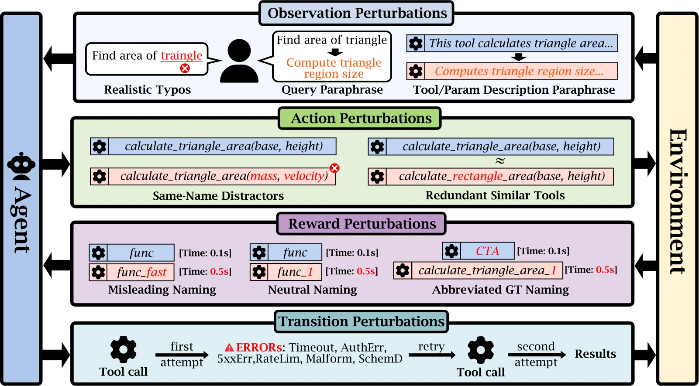
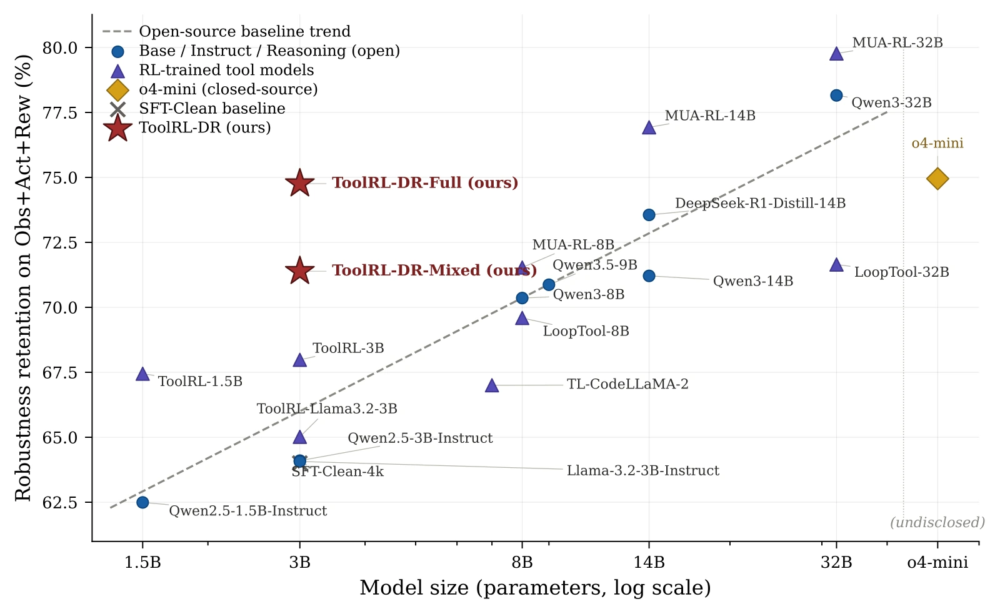

<div align="center">

# AgentRobustBench

[English](README.md) | **简体中文**

**A Sim-to-Real Benchmark and Domain-Randomized RL Recipe for Tool-Use Agents**

用于评测工具使用智能体在部署变化下的稳健性的基准，以及结合领域随机化的强化学习训练方法

NeurIPS 2026 · Evaluations & Datasets Track

[](https://arxiv.org/abs/2605.11928)
[](https://huggingface.co/datasets/AgentRobustBench/AgentRobustBench)
[](https://huggingface.co/spaces/willchow66/AgentRobustBench)

**199 个原始任务 · 22 种扰动 · 3,721 个评测案例 · 已评测 21 个模型**

[完整 benchmark 评测](#完整-benchmark-评测) · [基准介绍](#基准介绍) · [实验结果](#实验结果) · [模型权重](#模型权重) · [训练复现](#训练复现) · [引用](#引用)

</div>

AgentRobustBench 评测语言智能体在实际部署变化下能否正确使用工具，例如用户输入有错别字、工具名称容易混淆，或工具调用出现超时。我们同时提供 ToolRL-DR 训练方法，通过在训练中变化工具使用轨迹，提高模型的稳健性。

## 完整 benchmark 评测

使用 **ToolRL-DR-Full** 或 **ToolRL-DR-Mixed** 运行整个 AgentRobustBench：**3,721 个评测案例**，覆盖干净基线和全部 22 种扰动。先按自己的电脑选择运行方式：

| 你的电脑 | 运行方式 |
| --- | --- |
| 只有 CPU，包括 Intel Mac | 使用 `--device cpu`，不需要 GPU 或 vLLM 服务。 |
| Apple 芯片的 Mac | macOS 和 PyTorch 支持时，通过 **MPS** 使用电脑自带的 Apple GPU，运行时选择 `--device auto`。不需要 NVIDIA 显卡或 CUDA。 |
| Windows / Linux，配有 NVIDIA 显卡 | 通过 **CUDA** 使用 GPU，运行时选择 `--device auto`。需要匹配的 NVIDIA 驱动和 CUDA 版 PyTorch，安装方式见[官方安装选择器](https://pytorch.org/get-started/locally/)。支持的 Linux 机器也可使用 [vLLM 服务方式](scripts/README.md)。 |
| Windows，配有 Intel / AMD 显卡 | 当前入口没有专门适配这些 GPU 后端，本流程使用 `--device cpu`。 |
| 连接另一台模型服务器的电脑 | 只安装[评测客户端](scripts/README.md#if-you-already-have-a-model-server)，由服务器运行模型。 |

可用的 GPU 通常能加快**模型生成预测**的过程。具体提升取决于 GPU、可用内存或显存，以及输入输出长度；这两个 checkpoint 的实际提速尚未测量。规则评分在 CPU 上完成，首次下载模型的速度也不会因为使用 GPU 而提升。

两个 HF checkpoint 的权重文件**各约 13.6 GB**。CPU 推理使用 float32，除权重外还需要额外运行内存；**建议从 32 GB 内存的机器开始尝试，这不是实测最低配置**。使用加速器时会选择半精度。首次下载及推理耗时取决于机器和网络，已验证的范围见[复现说明](docs/REPRODUCIBILITY.md)。

### 第一步：安装 Python 环境和项目依赖

第一次配置时，建议通过 **Conda** 安装 Python，并创建独立环境。

**还没有 Conda 时，先安装。** 运行 `conda --version`；如果提示找不到命令，按照 [Miniforge 官方安装指引](https://github.com/conda-forge/miniforge#install)，选择与你的操作系统和芯片匹配的安装程序。Mac / Linux 安装后重新打开终端；Windows 从开始菜单打开 **Miniforge Prompt**。已经装过 Anaconda、Miniconda 或 Miniforge 的读者，可以直接使用已有的 Conda。

**本流程统一使用一个 Conda 环境。** 使用 `conda activate` 激活即可，不再额外创建 `.venv`。Windows 使用 Miniforge Prompt，或者已经能正常执行 Conda 命令的 PowerShell。

**创建环境，同时安装 Python 3.12、pip 和 Git：**

```bash
conda create -n agentrobustbench -c conda-forge --override-channels python=3.12 pip git -y
conda activate agentrobustbench
python --version
git --version
```

第一条命令会安装 Python 本身，不需要事先再单独安装系统 Python。后续命令都在这个已激活的环境里执行。如果你已经按照旧版说明配置好了 Python 3.11/3.12 的 `.venv`，继续使用它即可，直接从下面下载项目的步骤开始。

**下载项目：**

```bash
git clone --depth 1 https://github.com/WillChow66/AgentRobustBench.git
cd AgentRobustBench
```

如果已经下载过项目，进入已有的项目目录执行 `git pull`，不用再次克隆。

**安装依赖。** Mac 直接执行后面的 requirements 安装命令即可。Linux / Windows 如果只用 CPU，先安装 CPU 版 PyTorch：

```bash
python -m pip install torch --index-url https://download.pytorch.org/whl/cpu
```

Linux / Windows 如果使用 NVIDIA GPU，先按照 [PyTorch 官方安装选择器](https://pytorch.org/get-started/locally/)安装 CUDA 版 PyTorch。然后，所有平台都执行项目依赖安装：

```bash
python -m pip install -r scripts/requirements-local.txt
```

这一步也会安装下面下载 checkpoint 要用的 Hugging Face `hf` 命令。

### 第二步：检查环境

```bash
python scripts/evaluate_checkpoint.py --device auto --check
```

这会显示电脑类型、所选设备、可用系统内存和依赖版本，**不会下载模型**。查看输出中的 `Device:`：

| 输出 | 模型推理使用的设备 |
| --- | --- |
| `Device: mps` | 通过 Apple MPS 使用 Mac 的 GPU。 |
| `Device: cuda` | 通过 CUDA 使用 NVIDIA GPU。 |
| `Device: cpu` | 使用 CPU，未检测到可用且受支持的加速设备。 |

`auto` 按 CUDA → MPS → CPU 的顺序选择。如果 Windows / Linux 有 NVIDIA 显卡却显示 `cpu`，请检查 NVIDIA 驱动和 CUDA 版 PyTorch。Mac 则需要检查当前 macOS 与 PyTorch 是否支持 MPS。也可以将 `auto` 明确改成 `cpu`、`mps` 或 `cuda`；如果指定设备不可用，脚本会报错提示。

### 第三步：下载 Full 或 Mixed checkpoint

下载你想评测的模型即可；如果要评测两个模型，就分别运行两条下载命令。

**下载 Full：**

```bash
hf download willchow66/ToolRL-DR-Full-Qwen2.5-3B --revision caf3c8dfd3f9914d056892c3ab740d35ee9a0eab
```

**下载 Mixed：**

```bash
hf download willchow66/ToolRL-DR-Mixed-Qwen2.5-3B --revision c93ea7730b10cb0c16025705f2753859ec639a5e
```

命令中的版本与[评测脚本配置](configs/checkpoints.json)一致。下载结束后会显示本地缓存路径。**同版本文件已经在缓存里时会直接复用，只下载缺少的文件，不会重新存一整份。** 不需要把权重复制到项目目录，也不需要手动把缓存路径填进评测命令。这两个模型仓库都是公开的，下载无需登录 HF。

### 第四步：选择评测范围

- [(1) 完整评测](#1-完整评测)：跑全部 3,721 个案例，和论文结果对照。
- [(2) 复现单项结果](#2-复现单项结果)，运行论文中某项指标所需的全部案例。
- [(3) 按类别评测或抽样](#3-按类别评测或抽样)：只跑指定大类或小类，也可以每个小类抽几条快速试跑。

#### (1) 完整评测

每个模型评测 3,721 个案例。

运行 Full：

```bash
python scripts/evaluate_checkpoint.py --checkpoint full --suite full --device auto
```

运行 Mixed：

```bash
python scripts/evaluate_checkpoint.py --checkpoint mixed --suite full --device auto
```

`--checkpoint full` 或 `--checkpoint mixed` 选择模型，`--suite full` 运行完整 benchmark，也是脚本的默认范围。以下示例都可以将 `--checkpoint full` 换成 `--checkpoint mixed`。脚本自动复用 Hugging Face 缓存，缺少的权重会在运行时下载；评测数据已随仓库提供。若要指定 CPU，使用 `--device cpu`。

#### (2) 复现单项结果

从[实验结果表](#实验结果)中选一个分数。例如，要复现 **Mixed 的 ΔTrn（0.232）**，在仓库目录运行下面的命令。

```bash
python scripts/evaluate_checkpoint.py --checkpoint mixed --metric trn --device auto
```

**`--metric` 可选值**　`clean`（Clean）、`pert`（Pert. Acc.）、`obs`（ΔObs）、`act`（ΔAct）、`rew`（ΔRew）、`trn`（ΔTrn）。

用 `--checkpoint full` 或 `--checkpoint mixed` 选模型，再用 `--metric` 选指标。脚本会运行该指标所需的全部案例，在终端打印分数，并保存到 `table2_metrics.json`。

本地推理的分数可能因设备或数值精度而异。论文的推理设置见[附录 K](https://arxiv.org/pdf/2605.11928)。

#### (3) 按类别评测或抽样

用 `--select` 选择范围，用 `--samples-per-type` 控制每个小类的抽样数量。

**可选范围**

- `clean`：无扰动基线（199 个案例）。
- `observation`（观测，4 个小类，共 796 个案例）：
  - `realistic_typos`（错别字）、`query_paraphrase`（改写用户问题）。
  - `paraphrase_tool_description`（改写工具描述）、`paraphrase_parameter_description`（改写参数描述）。
- `action`（动作，6 个小类，共 836 个案例）：
  - `same_name_A`、`same_name_B`、`same_name_C`、`same_name_D`、`same_name_E`（五种同名干扰）。
  - `redundant`（加入功能相近的干扰工具）。
- `reward`（影响工具选择的元信息，6 个小类，共 696 个案例）：
  - `CD`、`CD_NT`、`CD_AB`（三种命名条件下的误导性描述）。
  - `TD`、`TD_NT`、`TD_AB`（三种命名条件下的响应时间描述）。
- `transition`（运行时错误，6 个小类，共 1,194 个案例）：
  - `timeout`（超时）、`rate_limit`（429 限流）、`auth_error`（401 认证失败）。
  - `server_error`（500 服务端错误）、`malformed_response`（无效 JSON）、`schema_drift`（返回结构变化）。

**按类别运行或抽样**

```bash
# 跑一个大类的全部样本
python scripts/evaluate_checkpoint.py --checkpoint full --device auto --select observation

# 跑一个小类的全部样本
python scripts/evaluate_checkpoint.py --checkpoint full --device auto --select timeout

# 组合一个大类、一个小类和干净基线
python scripts/evaluate_checkpoint.py --checkpoint full --device auto --select observation timeout clean

# 从 observation 的四个小类各抽 5 条，共 20 条
python scripts/evaluate_checkpoint.py --checkpoint full --device auto --select observation --samples-per-type 5

# 只从超时小类抽 3 条
python scripts/evaluate_checkpoint.py --checkpoint full --device auto --select timeout --samples-per-type 3

# 快速试跑：干净基线与错别字小类各抽 3 条，共 6 条
python scripts/evaluate_checkpoint.py --checkpoint full --device auto --select clean realistic_typos --samples-per-type 3 --seed 42
```

`--select` 后的名字用空格分隔，区分大小写。选择大类会包含其全部小类，重叠选择只运行一次。需要同时评测干净基线时，请把 `clean` 加入列表。

`--samples-per-type N` 会从每个选中的小类（以及选中的 `clean`）随机抽最多 N 个符合单轮评测条件的案例，不重复抽取。同一数据版本和同一个 `--seed`（默认 42）可复用同一批样本。不传 `--select` 时，会对全部 22 个小类和干净基线各抽样。抽样会减少评测用时，模型仍需完整加载。

### 第五步：查看评测结果

评分器会打印本次实际评测数量 `n`，并显示 `results/` 下新建的结果目录。完整评测应显示 **`n=3721`**，子集评测的 `n` 取决于选择的类别和抽样数。

| 文件 | 内容 |
| --- | --- |
| `comparison.csv`（完整评测） | 本次测得的干净样本准确率、扰动样本准确率及四类扰动准确率，同时列出公开参考分数和相差的百分点。 |
| `table2_metrics.json`（完整评测或指定 `--metric`） | 对应论文表 2 的指标，包括准确率差值。 |
| `scores.json` | 全部汇总分数，包括按数据来源和扰动类型划分的结果。 |
| `*.predictions.jsonl`、`transition_*/*.predictions.jsonl` | 静态案例和运行时案例的模型输出及解析后的工具调用。 |
| `per_sample_scores.jsonl` | 每个评测案例的评分。 |
| `_run_summary.json` | 处理数量和错误数量。 |
| `run_metadata.json` | checkpoint 版本、数据哈希、选中小类、抽样设置、设备、精度、依赖版本、种子及耗时。 |

**对照论文表 2 时，查看 `table2_metrics.json`。** `Clean` 是 199 个干净案例的准确率，`Pert. Acc.` 是 3,522 个扰动案例的准确率。控制台最上方的 `accuracy` 混合了这两组案例。

子集评测请查看 `scores.json` 和 `per_sample_scores.jsonl`。更多指标定义见[复现说明](docs/REPRODUCIBILITY.md)；使用独立模型服务时，参考 [vLLM 评测指南](scripts/README.md)。

## 基准介绍



| 类别 | 改变的内容 | 示例 |
| --- | --- | --- |
| Observation：观测 | 智能体看到的输入 | 用户问题中出现错别字 |
| Action：动作 | 可选择的工具 | 加入同名的干扰工具 |
| Reward-relevant metadata：影响工具选择的元信息 | 引导工具选择的信息 | 误导性的工具名称或响应时间说明 |
| Transition：状态转移 | 工具调用后的返回结果 | 首次调用出现暂时性超时 |

[Hugging Face 数据集](https://huggingface.co/datasets/AgentRobustBench/AgentRobustBench) 包含 **2,718 条静态记录**。默认的单轮评测运行其中 **2,527 条**，跳过 **191 条多轮记录**，再增加 **1,194 个运行时案例**（199 个干净任务 × 6 种错误），合计 **3,721 个评测案例**。可以在[在线排行榜](https://huggingface.co/spaces/willchow66/AgentRobustBench)查看模型和各类扰动的得分。

## 实验结果

下表列出我们两个公开 checkpoint 在[论文表 2](https://arxiv.org/pdf/2605.11928#page=7)中的点估计。每个 Δ 指标等于干净样本准确率减去对应扰动大类的准确率。21 个模型的完整分数见[排行榜](https://huggingface.co/spaces/willchow66/AgentRobustBench)。

| 指标 | ToolRL-DR-Full | ToolRL-DR-Mixed | 评测范围 | 命令参数 |
| --- | ---: | ---: | --- | --- |
| Clean ↑ | 0.643 | 0.658 | 199 个干净案例 | `--metric clean` |
| Pert. Acc. ↑ | 0.463 | 0.461 | 3,522 个扰动案例 | `--metric pert` |
| ΔObs ↓ | 0.009 | 0.049 | 干净案例 + Observation (995 个) | `--metric obs` |
| ΔAct ↓ | 0.147 | 0.152 | 干净案例 + Action (1,035 个) | `--metric act` |
| ΔRew ↓ | 0.331 | 0.364 | 干净案例 + Reward (895 个) | `--metric rew` |
| ΔTrn ↓ | 0.231 | 0.232 | 干净案例 + Transition (1,393 个) | `--metric trn` |

可直接运行的示例及输出位置见[第四步（2）](#2-复现单项结果)。



图中比较模型在 Observation、Action 和 Reward 扰动下相对干净样本保留了多少准确率。在 3B 参数规模下，ToolRL-DR-Full 的保持比例高于同规模 ToolRL 基线。在单独的运行时评测中，它在未使用 Transition 错误训练的情况下，将对应准确率差距缩小了约 27%。指标定义与实验设置见[论文](https://arxiv.org/abs/2605.11928)。

## 仓库结构

| 目录 | 内容 |
| --- | --- |
| `hf_data/datasets/api_eval/` | 17 个 JSONL 文件，包含干净样本和 16 种静态扰动；6 种 Transition 扰动由运行器在评测时生成。 |
| `scripts/` | 推理运行器、解析脚本、依赖和模型配置，以及 SLURM 作业模板。详见[评测指南](scripts/README.md)。 |
| `leaderboard/` | Gradio 排行榜应用、确定性评分器和公开分数表。 |
| `training/` | ToolRL-DR-Full 和 ToolRL-DR-Mixed 的训练数据、数据转换脚本、奖励函数补丁、训练启动脚本和超参数。详见[训练指南](training/README.md)。 |

## 模型权重

| 模型 | 训练数据 | 下载与模型说明 |
| --- | --- | --- |
| ToolRL-DR-Full | 扰动后的轨迹 | [Hugging Face](https://huggingface.co/willchow66/ToolRL-DR-Full-Qwen2.5-3B) |
| ToolRL-DR-Mixed | 干净轨迹与扰动轨迹混合 | [Hugging Face](https://huggingface.co/willchow66/ToolRL-DR-Mixed-Qwen2.5-3B) |

两个模型均基于 Qwen2.5-3B-Instruct，使用 [Qwen Research License](https://huggingface.co/Qwen/Qwen2.5-3B-Instruct/blob/main/LICENSE)。

## 训练复现

`training/data/` 提供 **3,905 条 Full 训练数据**、**4,000 条 Mixed 训练数据**，以及两者共享的 **79 条验证数据**。按照[训练指南](training/README.md)完成 ToolRL 安装、奖励函数补丁和 `PYTHONPATH` 配置后，运行：

```bash
TRAIN_FILE=training/data/train.parquet \
VAL_FILE=training/data/test.parquet \
BASE_MODEL=Qwen/Qwen2.5-3B-Instruct \
EXPERIMENT_NAME=toolrl-dr-full \
N_GPUS=2 ROLLOUT_TP_SIZE=1 \
bash training/grpo_launch.sh
```

训练 Mixed 时，将 `TRAIN_FILE` 换成 `training/data/mixed_train.parquet`。训练需要额外的 GPU 资源和时间。

## 引用

下面保留当前仓库提供的 arXiv 引用条目：

```bibtex
@misc{zhou2026whensimulationlies,
  title         = {When Simulation Lies: A Sim-to-Real Benchmark and Domain-Randomized RL Recipe for Tool-Use Agents},
  author        = {Zhou, Xiaolin and Yuan, Aojie and Luo, Zheng and Ling, Zipeng and
                   Pan, Xixiao and Gao, Yicheng and Zhang, Haiyue and Li, Jiate and
                   Jiang, Shuli and Wang, Prince Zizhuang and Zhu, Zixuan and
                   Liu, Jinbo and Rossi, Ryan A. and Wei, Hua and Hu, Xiyang},
  year          = {2026},
  eprint        = {2605.11928},
  archivePrefix = {arXiv},
  primaryClass  = {cs.AI}
}
```

## 许可证

代码使用 [Apache-2.0](LICENSE)。数据的来源许可证见论文和各数据来源的说明。
