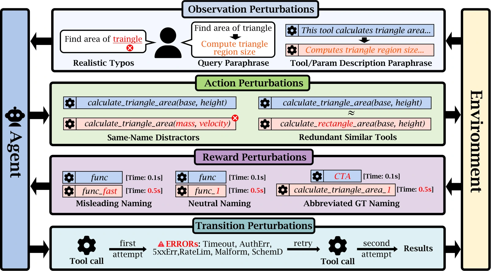
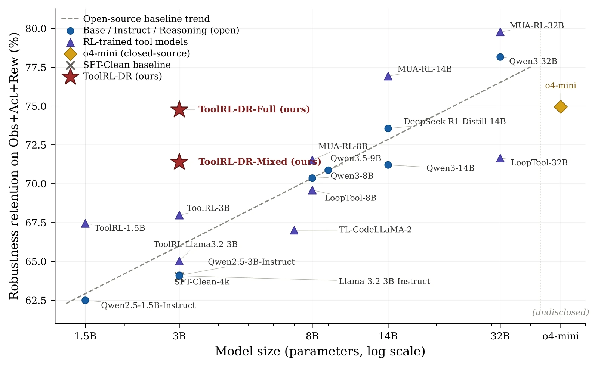

<div align="center">

# AgentRobustBench

[English](README.md) | **简体中文**

**A Sim-to-Real Benchmark and Domain-Randomized RL Recipe for Tool-Use Agents**

用于评测工具使用智能体在部署变化下的稳健性的基准，以及结合领域随机化的强化学习训练方法

NeurIPS 2026 · Evaluations & Datasets Track

[](https://arxiv.org/abs/2605.11928)
[](https://huggingface.co/datasets/AgentRobustBench/AgentRobustBench)
[](https://huggingface.co/spaces/willchow66/AgentRobustBench)

**199 个原始任务 · 22 种扰动 · 3,721 个评测案例 · 已评测 21 个模型**

[运行六个模型评测样本](#运行六个模型评测样本) · [基准介绍](#基准介绍) · [实验结果](#实验结果) · [模型权重](#模型权重) · [完整评测](#完整评测) · [训练复现](#训练复现) · [引用](#引用)

</div>

AgentRobustBench 评测语言智能体在实际部署变化下能否正确使用工具，例如用户输入有错别字、工具名称容易混淆，或工具调用出现超时。我们同时提供 ToolRL-DR 训练方法，通过在训练中变化工具使用轨迹，提高模型的稳健性。

## 运行六个模型评测样本

这一步会加载你选择的 checkpoint，对**三个干净任务及其三个错别字版本**生成预测，再进行评分。先按自己的电脑选择运行方式：

| 你的电脑 | 运行方式 |
| --- | --- |
| 只有 CPU，包括 Intel Mac | 使用 `--device cpu`，不需要 GPU 或 vLLM 服务。 |
| Apple 芯片的 Mac | 使用 `--device auto`，有可用的 MPS 时会使用 Apple GPU；也可以指定 `--device cpu`。 |
| 有 NVIDIA GPU 的机器 | 使用 `--device auto` 直接推理，或使用 [vLLM 服务方式](scripts/README.md)。 |
| 连接另一台模型服务器的电脑 | 只安装[评测客户端](scripts/README.md#if-you-already-have-a-model-server)，由服务器运行模型。 |

两个 HF checkpoint 的权重文件**各约 13.6 GB**。CPU 推理使用 float32，除权重外还需要额外运行内存；**建议从 32 GB 内存的机器开始尝试，这不是实测最低配置**。使用加速器时会选择半精度。首次下载及推理耗时取决于机器和网络，已验证的范围见[复现说明](docs/REPRODUCIBILITY.md)。

### 第一步：安装环境

需要 [Python 3.11 或 3.12](https://www.python.org/downloads/) 和 [Git](https://git-scm.com/downloads)。Mac / Linux 打开终端，Windows 打开 PowerShell。下载项目并建立独立环境：

```bash
git clone --depth 1 https://github.com/WillChow66/AgentRobustBench.git
cd AgentRobustBench
python3 -m venv .venv
source .venv/bin/activate
python -m pip install -r scripts/requirements-local.txt
```

如果已经下载过仓库，直接进入已有目录，跳过克隆。Windows 用户将上面的最后三行替换为：

```powershell
py -3.12 -m venv .venv
.\.venv\Scripts\python.exe -m pip install -r scripts/requirements-local.txt
```

Windows 中，以下命令的 `python` 都换成 `.\.venv\Scripts\python.exe`。Linux / Windows 如果只使用 CPU，可以先安装 CPU 版 PyTorch，再安装 requirements：`python -m pip install torch --index-url https://download.pytorch.org/whl/cpu`。Mac 使用上面的普通安装命令即可。

### 第二步：检查环境

```bash
python scripts/evaluate_checkpoint.py --device cpu --check
```

这会显示电脑类型、所选设备和依赖版本，**不会下载模型**。如果希望使用 GPU，将 `cpu` 换成 `auto`，脚本会检查可用的 CUDA 或 Apple MPS。

### 第三步：运行 Full 或 Mixed

运行 Full：

```bash
python scripts/evaluate_checkpoint.py --checkpoint full --device cpu
```

运行 Mixed：

```bash
python scripts/evaluate_checkpoint.py --checkpoint mixed --device cpu
```

脚本会自动加载对应的 HF tokenizer 和 checkpoint，使用基准原有的提示词与解析器生成预测，再调用原有评分器。评测数据已经随仓库提供，无需另外下载。首次下载后通常会复用 HF 本地缓存。如果希望自动选择 CUDA、Apple MPS 或 CPU，将 `--device cpu` 改成 `--device auto`。

### 第四步：查看结果

评分器会打印 **`n=6`**，以及由这次模型预测得到的准确率。最后一行会显示 `results/` 下新建的输出目录，里面包含：

| 文件 | 内容 |
| --- | --- |
| `clean.predictions.jsonl`、`realistic_typos.predictions.jsonl` | 模型生成的文本及解析出的工具调用。 |
| `scores.json` | 汇总准确率。 |
| `per_sample_scores.jsonl` | 每个样本的评分。 |
| `_run_summary.json` | 处理数量和错误数量。 |
| `run_metadata.json` | checkpoint 版本、数据哈希、设备、精度、依赖版本、种子，以及这次运行实测的加载和评测耗时。 |

六样本用于跑通流程。如果要评测所有案例，并将新测得的分数与公开分数比较，运行：

```bash
python scripts/evaluate_checkpoint.py --checkpoint full --suite full --device auto
python scripts/evaluate_checkpoint.py --checkpoint mixed --suite full --device auto
```

完整评测会评分 **3,721 个案例**，并额外生成 `comparison.csv`，列出实际得分、公开得分及相差多少个百分点。更多参数、验证范围与论文指标对应关系见[复现说明](docs/REPRODUCIBILITY.md)。

## 基准介绍



| 类别 | 改变的内容 | 示例 |
| --- | --- | --- |
| Observation：观测 | 智能体看到的输入 | 用户问题中出现错别字 |
| Action：动作 | 可选择的工具 | 加入同名的干扰工具 |
| Reward-relevant metadata：影响工具选择的元信息 | 引导工具选择的信息 | 误导性的工具名称或响应时间说明 |
| Transition：状态转移 | 工具调用后的返回结果 | 首次调用出现暂时性超时 |

[Hugging Face 数据集](https://huggingface.co/datasets/AgentRobustBench/AgentRobustBench) 包含 **2,718 条静态记录**。默认的单轮评测运行其中 **2,527 条**，跳过 **191 条多轮记录**，再增加 **1,194 个运行时案例**（199 个干净任务 × 6 种错误），合计 **3,721 个评测案例**。可以在[在线排行榜](https://huggingface.co/spaces/willchow66/AgentRobustBench)查看模型和各类扰动的得分。

## 实验结果



图中比较模型在 Observation、Action 和 Reward 扰动下相对干净样本保留了多少准确率。在 3B 参数规模下，ToolRL-DR-Full 的保持比例高于同规模 ToolRL 基线。在单独的运行时评测中，它在未使用 Transition 错误训练的情况下，将对应准确率差距缩小了约 27%。指标定义与实验设置见[论文](https://arxiv.org/abs/2605.11928)。

## 仓库结构

| 目录 | 内容 |
| --- | --- |
| `hf_data/datasets/api_eval/` | 17 个 JSONL 文件，包含干净样本和 16 种静态扰动；6 种 Transition 扰动由运行器在评测时生成。 |
| `scripts/` | 推理运行器、解析脚本、依赖和模型配置，以及 SLURM 作业模板。详见[评测指南](scripts/README.md)。 |
| `leaderboard/` | Gradio 排行榜应用、确定性评分器和公开分数表。 |
| `training/` | ToolRL-DR-Full 和 ToolRL-DR-Mixed 的训练数据、数据转换脚本、奖励函数补丁、训练启动脚本和超参数。详见[训练指南](training/README.md)。 |

## 模型权重

| 模型 | 训练数据 | 下载与模型说明 |
| --- | --- | --- |
| ToolRL-DR-Full | 扰动后的轨迹 | [Hugging Face](https://huggingface.co/willchow66/ToolRL-DR-Full-Qwen2.5-3B) |
| ToolRL-DR-Mixed | 干净轨迹与扰动轨迹混合 | [Hugging Face](https://huggingface.co/willchow66/ToolRL-DR-Mixed-Qwen2.5-3B) |

两个模型均基于 Qwen2.5-3B-Instruct，使用 [Qwen Research License](https://huggingface.co/Qwen/Qwen2.5-3B-Instruct/blob/main/LICENSE)。

## 完整评测

使用上面的 `--suite full` 命令即可运行所有静态文件和六种运行时扰动并评分。若使用独立的模型服务，参考 [vLLM 完整评测命令](scripts/README.md#full-benchmark-evaluation)。

集群用户可以使用 [`scripts/slurm/`](scripts/slurm/) 中的模板。提交作业前，需要替换为自己集群的账户、路径和调度器设置。

## 训练复现

训练用的 Parquet 文件已经放在 `training/data/` 中。按照[训练指南](training/README.md)完成 ToolRL 安装、奖励函数补丁和 `PYTHONPATH` 配置后，运行：

```bash
TRAIN_FILE=training/data/train.parquet \
VAL_FILE=training/data/test.parquet \
BASE_MODEL=Qwen/Qwen2.5-3B-Instruct \
EXPERIMENT_NAME=toolrl-dr-full \
N_GPUS=2 ROLLOUT_TP_SIZE=1 \
bash training/grpo_launch.sh
```

训练 Mixed 时，将 `TRAIN_FILE` 换成 `training/data/mixed_train.parquet`。训练需要额外的 GPU 资源和时间。

## 引用

下面保留当前仓库提供的 arXiv 引用条目：

```bibtex
@misc{zhou2026whensimulationlies,
  title         = {When Simulation Lies: A Sim-to-Real Benchmark and Domain-Randomized RL Recipe for Tool-Use Agents},
  author        = {Zhou, Xiaolin and Yuan, Aojie and Luo, Zheng and Ling, Zipeng and
                   Pan, Xixiao and Gao, Yicheng and Zhang, Haiyue and Li, Jiate and
                   Jiang, Shuli and Wang, Prince Zizhuang and Zhu, Zixuan and
                   Liu, Jinbo and Rossi, Ryan A. and Wei, Hua and Hu, Xiyang},
  year          = {2026},
  eprint        = {2605.11928},
  archivePrefix = {arXiv},
  primaryClass  = {cs.AI}
}
```

## 许可证

代码使用 [Apache-2.0](LICENSE)。数据的来源许可证见论文和各数据来源的说明。
